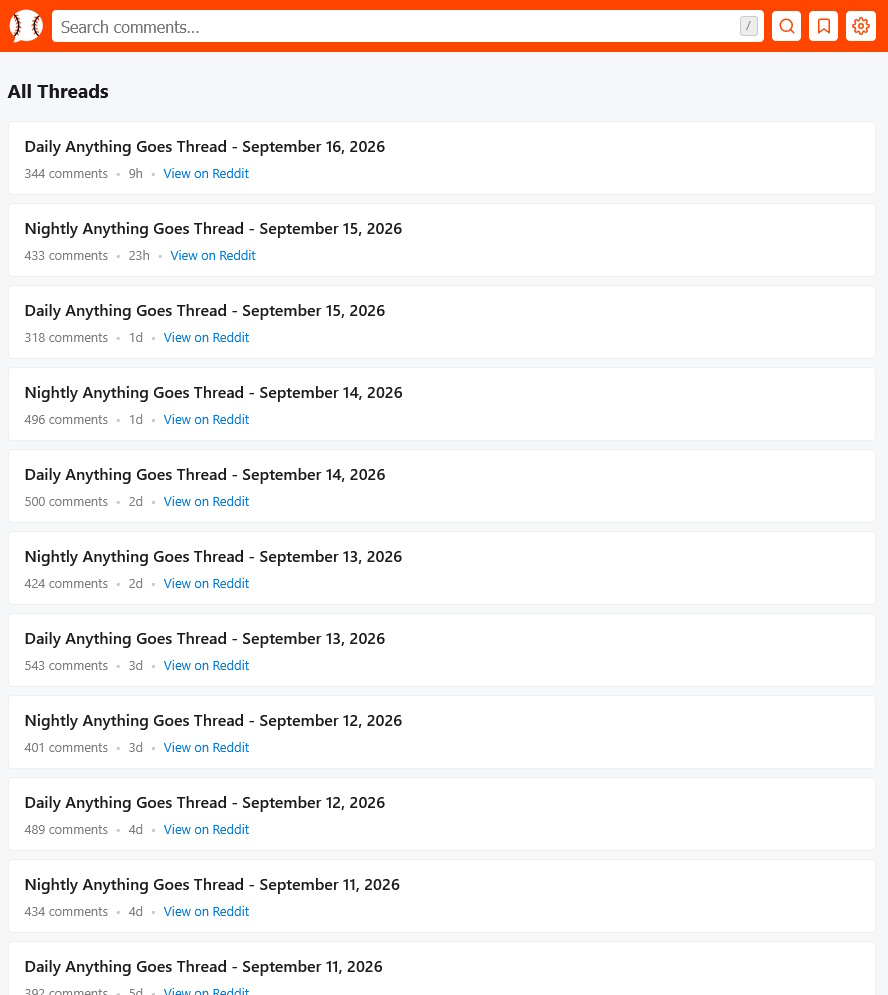
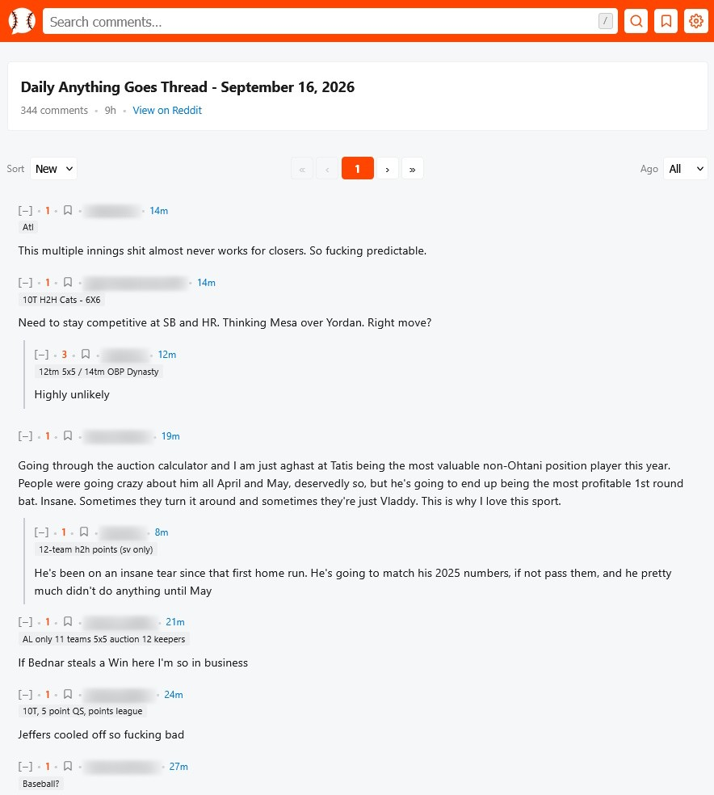
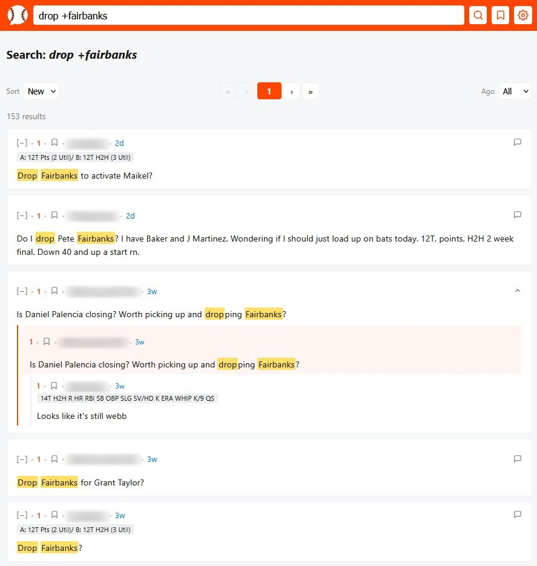
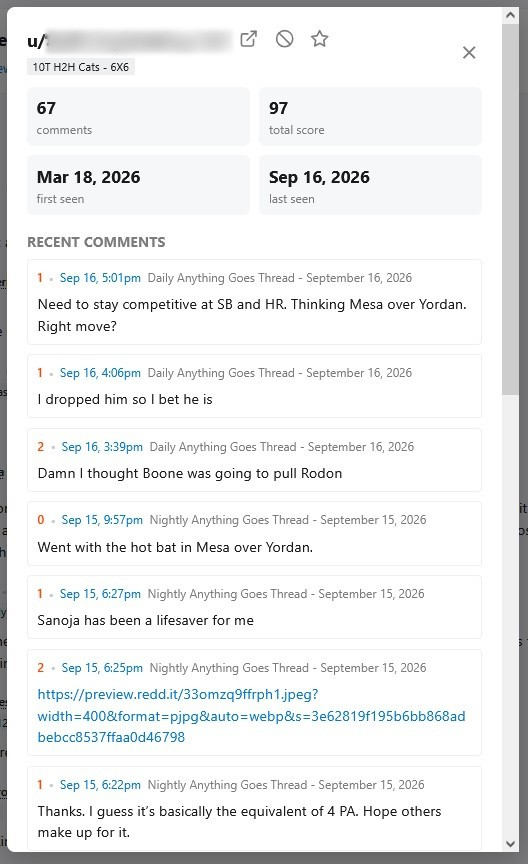
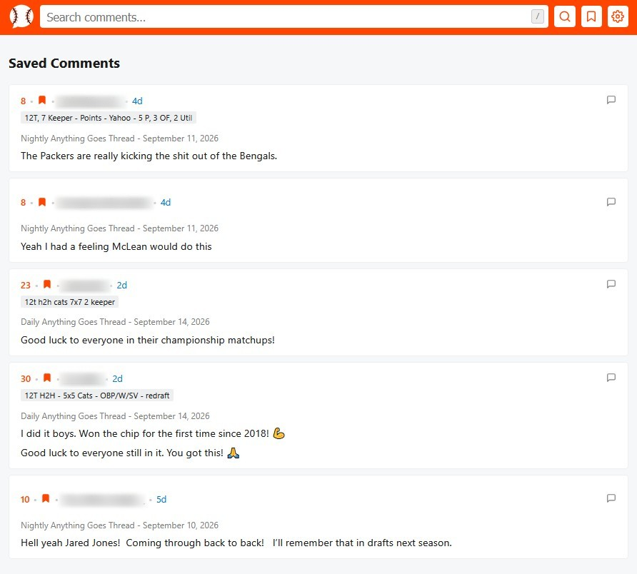
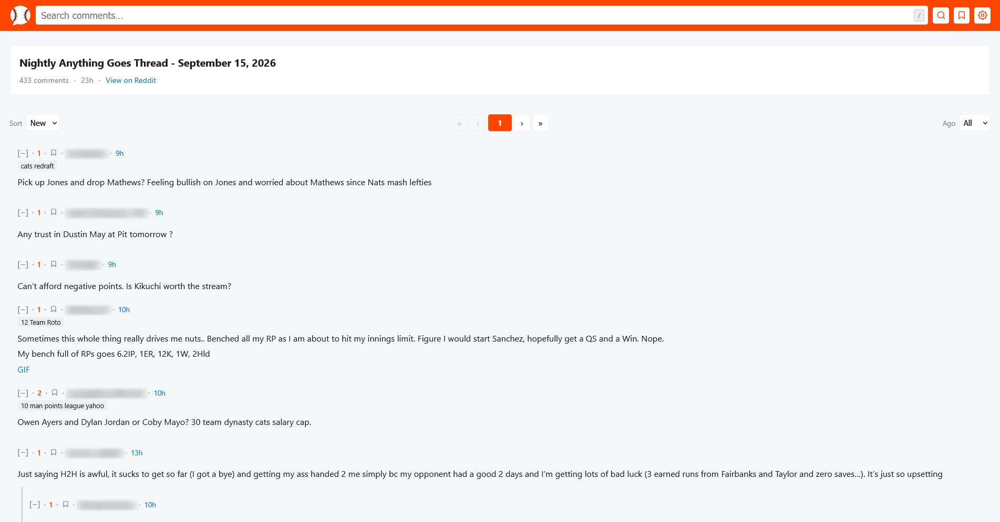
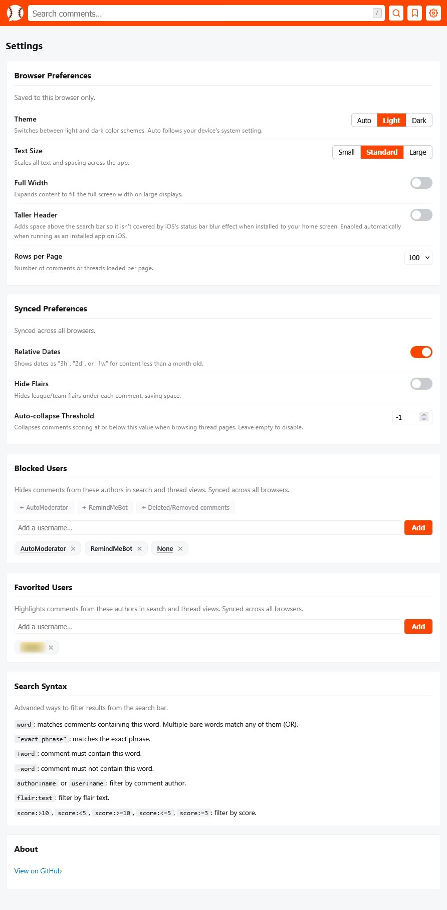
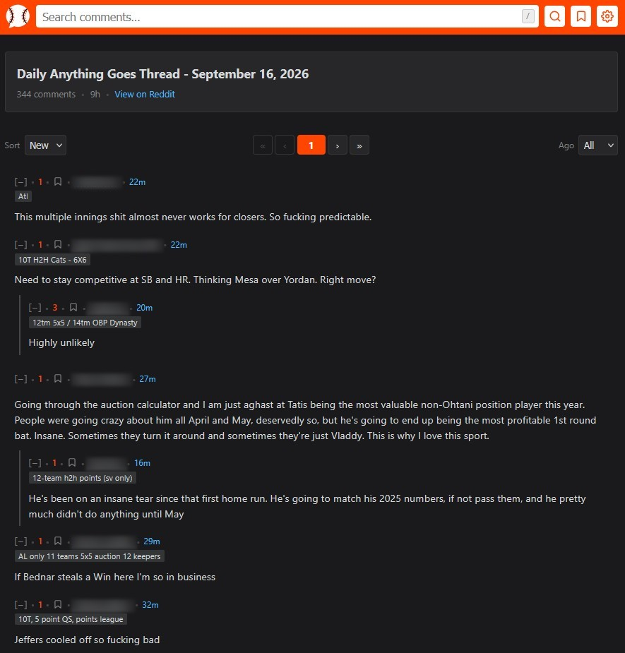
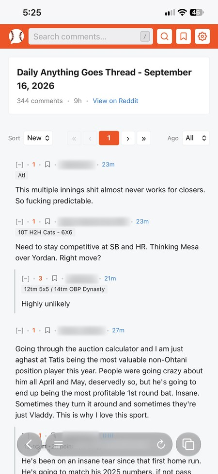
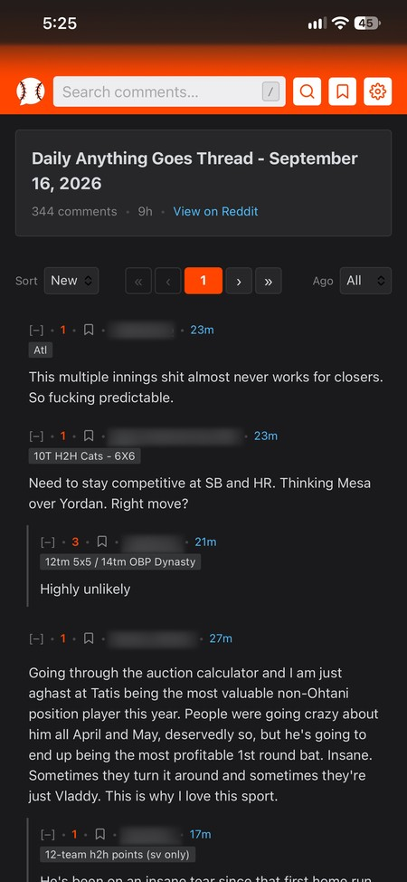

# Anything Goes Archive

[](https://github.com/wazam/r-fantasybaseball-indexer/actions/workflows/docker.yml)
[](https://github.com/wazam/r-fantasybaseball-indexer/actions/workflows/compose-test.yml)
[](https://github.com/wazam/r-fantasybaseball-indexer/actions/workflows/lint.yml)
[](https://github.com/wazam/r-fantasybaseball-indexer/releases)
[](https://hub.docker.com/r/wazam123/r-fantasybaseball-indexer)
[](https://hub.docker.com/r/wazam123/r-fantasybaseball-indexer)
[](https://github.com/wazam/r-fantasybaseball-indexer/pkgs/container/r-fantasybaseball-indexer)

 **Anything Goes Archive** is a self-hosted tool that automatically archives every Daily and Nightly "Anything Goes" thread from [r/fantasybaseball](https://www.reddit.com/r/fantasybaseball/). Tens of thousands of comments are stored locally with upvote scores, league flairs, and full reply structure. Search across all threads at once to track player discussions over time, compare sentiment across multiple days side by side, and find exactly what you need without fighting Reddit's search.

## Table of Contents

- [Features](#features)
- [Tech Stack](#tech-stack)
- [Set Up Reddit API Access](#set-up-reddit-api-access)
- [Quick Start](#quick-start)
  - [Run via Docker Compose](#run-via-docker-compose)
  - [Build from Source](#build-from-source)
- [Environment Variables](#environment-variables)
- [Your Data](#your-data)
- [Screenshots](#screenshots)
- [Contributing](#contributing)
- [Disclaimers](#disclaimers)
- [License](#license)

## Features

- **Web UI**: A mobile-friendly browser interface for browsing threads and comment trees, with sort, pagination, collapse/expand, and auto-collapse by score.
- **Search**: Syntax-aware search across the full archive, supporting exact phrases, required (+) and excluded (-) terms, author/flair filters, and score comparisons, with matched terms highlighted inline.
- **Author Profiles**: Tap any username to see their comment count, total score, first/last seen dates, and recent comment history.
- **Block and Favorite Users**: Hide unwanted commenters or highlight ones you follow, synced across every browser and device.
- **Saved Comments and Saved Searches**: Bookmark comments and save frequent search queries for one-tap access later.
- **Theming and Display Preferences**: Light, dark, or auto theme, adjustable text size, and a full-width layout option.
- **Installable Web App**: Add it to your phone's home screen for an app-like experience.
- **Scheduler**: Every 15 minutes, fetches newly posted threads and refreshes each thread for 36 hours after it's posted, then marks it inactive.
- **Comment Archiving**: Stores full comment trees with upvote scores, league flairs, reply counts, and parent/child relationships for full thread reconstruction.
- **Duplicate Prevention**: Tracks Reddit submission and comment IDs to avoid storing duplicates.
- **Change Tracking**: Updates edited comment bodies and upvote scores on each refresh, and keeps deleted and removed comments in the archive.
- **Rate Limit Handling**: Retries automatically when Reddit API rate limits are hit.
- **Gap Filling**: Each update looks back to the newest stored thread, or a week if that's more recent, so the first update after the app was stopped imports the threads it missed. Older threads can be imported once with the backfill tool (see [Your Data](#your-data)).
- **Health Check**: The image includes a Docker health check, so Docker and monitoring tools can tell when the archive stops responding.

## Tech Stack

- **Language and Runtime**: Python, with FastAPI for the web app served by uvicorn, managed with Pipenv.
- **Frontend and Templating**: Jinja2 for the HTML pages, with plain JavaScript and CSS, and a web app manifest so it can be installed to a home screen.
- **Database Layer**: SQLite through the SQLAlchemy ORM, a single file in the data folder.
- **Reddit API and Scheduling**: PRAW for Reddit's API, and APScheduler to run the updates.
- **Infrastructure and Deployment**: Docker and Docker Compose, with images for amd64 and arm64 on GitHub Container Registry and Docker Hub, both with a GitHub build provenance attestation.
- **Automation and CI/CD**: GitHub Actions builds and publishes the images for each release tag, tests both the source build and the published images, and lints the Python code.

## Set Up Reddit API Access

All install methods require a Reddit API app.

> [!WARNING]
> Reddit closed self-service API access starting November 2025 under its new [Responsible Builder Policy](https://www.reddit.com/r/redditdev/comments/1oug31u/introducing_the_responsible_builder_policy_new/). New apps now require approval, which tends to go unanswered for small hobby projects like this one. If you already have Reddit API credentials, they still work fine.

If you do have access, create an app at [reddit.com/prefs/apps](https://www.reddit.com/prefs/apps):

1. Click **"create another app..."**
2. Set the name to `Anything Goes Archive`, type to **script**, and redirect URI to `http://localhost`
3. Copy your `client_id` (shown under the app name) and `client_secret`

## Quick Start

> [!TIP]
> Run via Docker Compose is recommended for most users. No clone required.

> [!WARNING]
> Do not put this on the Internet if you do not know what you are doing.

### Run via Docker Compose

The image is published to [GitHub Container Registry](https://github.com/wazam/r-fantasybaseball-indexer/pkgs/container/r-fantasybaseball-indexer) (`ghcr.io/wazam/r-fantasybaseball-indexer`) and [Docker Hub](https://hub.docker.com/r/wazam123/r-fantasybaseball-indexer) (`wazam123/r-fantasybaseball-indexer`). `compose.yaml` uses GHCR.

1. **Create the data folder**

   ```sh
   mkdir -p data
   ```

   `data` holds the archive, `data.db` (see [Your Data](#your-data)). Create it before the first start, since a folder Docker creates belongs to root and the container can't write to it. The container runs as uid 1000 (`user: "1000:1000"` in `compose.yaml`), and on most single-user Linux machines your own account is uid 1000 (check with `id -u`), so a folder you create already has the right owner. If it has another owner (check with `ls -nd data`), either give it to uid 1000 with `sudo chown -R 1000:1000 data`, or, if that owner isn't root, set `user:` to it. The archive checks this when it starts, and if it can't write to `data`, it stops and logs the command that fixes it.

2. **Download `compose.yaml`**

   ```sh
   curl -O https://raw.githubusercontent.com/wazam/r-fantasybaseball-indexer/main/compose.yaml
   ```

   It looks like this:

   ```yaml
   services:
     anything-goes-archive:
       image: ghcr.io/wazam/r-fantasybaseball-indexer:latest
       container_name: anything-goes-archive
       restart: unless-stopped
       user: "1000:1000"
       environment:
         - REDDIT_CLIENT_ID=${REDDIT_CLIENT_ID}  # required
         - REDDIT_CLIENT_SECRET=${REDDIT_CLIENT_SECRET}  # required
         - REDDIT_USER_AGENT=${REDDIT_USER_AGENT:-}  # optional
         - TZ=${TZ:-UTC}  # optional
         - FORWARDED_ALLOW_IPS=${FORWARDED_ALLOW_IPS:-127.0.0.1,::1}  # optional
       volumes:
         - ./data:/app/data
       ports:
         - "9009:9009"
   ```

3. **Create `.env`**

   Next to `compose.yaml`, create a `.env` file with these two lines, filled in with your Reddit app's client ID and secret (see [Set Up Reddit API Access](#set-up-reddit-api-access)). To change any other setting, add it the same way, one `NAME=value` per line. [Environment Variables](#environment-variables) lists each setting and its default.

   ```sh
   REDDIT_CLIENT_ID=
   REDDIT_CLIENT_SECRET=
   ```

   Without the two credentials, or with ones Reddit rejects, the archive stops at startup with an `ERROR` line in `docker compose logs`.

4. **Start the stack**

   ```sh
   docker compose up -d
   ```

5. **Open the web UI**

   Visit [http://localhost:9009](http://localhost:9009) in your browser.

### Build from Source

1. **Clone the repository**

   ```sh
   git clone https://github.com/wazam/r-fantasybaseball-indexer.git
   cd r-fantasybaseball-indexer
   ```

2. **Create the data folder**

   ```sh
   mkdir -p data
   ```

   It needs the same owner as in step 1 of [Run via Docker Compose](#run-via-docker-compose).

3. **Create `.env`**

   In the repo folder, as in step 3 of [Run via Docker Compose](#run-via-docker-compose).

4. **Build and start the stack**

   ```sh
   docker compose up -d --build
   ```

   Inside the repo, `docker compose` also loads `compose.override.yaml`, which builds the image from source as `r-fantasybaseball-indexer:local`, so a local build never replaces the published image. To run the published image from the repo folder instead, use `docker compose -f compose.yaml up -d`.

5. **Open the web UI** as in step 5 of [Run via Docker Compose](#run-via-docker-compose)

## Environment Variables

Set these in a `.env` file next to `compose.yaml`, one `NAME=value` per line. An empty value uses the default. A value the archive can't use, such as credentials Reddit rejects, stops it at startup with an `ERROR` line in `docker compose logs` naming the setting.

| Variable | Description | Required | Default |
|---|---|---|---|
| `REDDIT_CLIENT_ID` | Reddit app client ID, the string under the app name at [reddit.com/prefs/apps](https://www.reddit.com/prefs/apps) (see [Set Up Reddit API Access](#set-up-reddit-api-access)). | Yes | |
| `REDDIT_CLIENT_SECRET` | Reddit app client secret, the "secret" field at [reddit.com/prefs/apps](https://www.reddit.com/prefs/apps). | Yes | |
| `REDDIT_USER_AGENT` | User agent sent to Reddit's API. Reddit asks each app to identify itself with its own username, in the form `platform:app:version (by /u/your_username)`. Leave unset to use the built-in one, `linux:r-fantasybaseball-indexer:v<version> (by /u/wazam)`, which names this project's author. | No | |
| `TZ` | Time zone for the web UI's dates and the timestamps in the container's logs, as a [tz database name](https://en.wikipedia.org/wiki/List_of_tz_database_time_zones#List) such as `America/New_York`. An unknown name logs a warning and uses UTC. | No | `UTC` |
| `FORWARDED_ALLOW_IPS` | Reverse proxy IPs to trust for `X-Forwarded-For` and `X-Forwarded-Proto` headers, comma-separated, with CIDR ranges allowed (`10.0.0.0/24`, not `10.0.0.5/24`). Behind a reverse proxy, set this to the proxy's address as the container sees it, so the access log shows real client IPs and redirects keep `https://`: the proxy container's address on a shared Docker network, or the network's gateway (from `docker network inspect`) when the proxy runs on the host. Use `*` only if nothing but the proxy can reach port 9009. | No | `127.0.0.1,::1` |

## Your Data

Everything the app stores is in one SQLite file, `./data/data.db`: the archived threads and comments, plus your blocked and favorited users, saved comments, saved searches and synced preferences. Browser preferences (theme, text size, full width, rows per page, taller header) stay in each browser. Threads from February to early November 2026 (about 415,000 comments) take about 200 MB.

- **Ownership:** the container runs as uid 1000 and needs to write to `./data` (see [Run via Docker Compose](#run-via-docker-compose)).
- **Backups:** stop the container, then copy `data.db`. A copy taken while the app is writing can be incomplete.
- **Moving or starting over:** put `data.db` in the new host's `./data` folder, or delete it to start fresh. The tables are created on startup.
- **Importing older threads:** run `docker exec anything-goes-archive ./.venv/bin/python -m app.threads.backfill YYYY-MM-DD` once to import threads from that date on. Reddit's search lists only its newest 250 threads, about four months, so neither the backfill nor the regular updates reach further back.

## Screenshots



Thread list sorted by date, with comment counts, how recently each thread was active, and a link back to the original Reddit post.



Thread detail page with a nested comment tree, sort controls, and a date filter.



Search results for a multi-term query, with matched words highlighted inline.



Tapping any username opens their profile: total comments and score, first/last seen dates, and their recent comment history.



Comments bookmarked with the save icon collect here for quick reference later.



Full width and Large text size, two of several display preferences available in Settings.



Settings page: device-only display preferences, preferences synced across browsers, Blocked/Favorited Users management, and a Search Syntax reference.



Dark mode, available as a manual choice or set to follow your device automatically.



The mobile layout in a regular browser tab.



Installed to the home screen as a PWA for an app-like experience, with an extra-tall header available in Settings to work around iOS's status bar effects.

## Contributing

Report bugs or feature requests by opening an issue on the [GitHub repository](https://github.com/wazam/r-fantasybaseball-indexer/issues). See [CHANGELOG.md](CHANGELOG.md) for what changed in each release, [ROADMAP.md](ROADMAP.md) for planned and proposed features, and [RELEASING.md](RELEASING.md) for how a release is made.

## Disclaimers

- [Reddit User Agreement](https://redditinc.com/policies/user-agreement)

## License

This project is licensed under the [MIT License](LICENSE).
